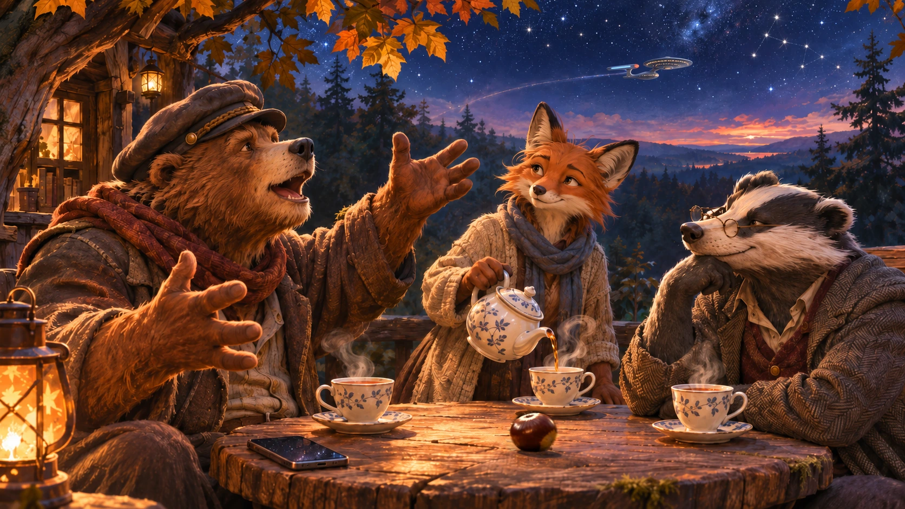

Der Regen hatte am Nachmittag aufgehört. Auf dem Waldtisch lagen einige nasse Blätter, eine Kastanie und Faulmanns Telefon.

Dachsbert betrachtete das Telefon.

"Du hast die Nachricht jetzt oft genug gelesen", sagte er.

"Das ändert nichts daran, dass sie falsch sein sollte."

"Sie ist aber nicht falsch."

"Ich weiß."

Sir Patrick Stewart war gestorben.

Faulmann hatte seit dem Morgen versucht, einen vernünftigen Umgang mit dieser Tatsache zu finden. Es war ihm nicht gelungen. Dabei hatte er sich für gewöhnlich einiges auf seine Vernunft eingebildet.

"Der Captain hat die Brücke verlassen", sagte er schließlich.

Dachsbert rückte seine Brille zurecht.

"Genau genommen war er Schauspieler."

Faulmann sah ihn an.

"Ja, Dachsbert. Das weiß ich."

"Ich erwähne es nur, weil du seit einer Stunde von einem Captain sprichst."

"Und ich versuche seit einer Stunde, dir zu erklären, weshalb."

"Bislang mit mäßigem Erfolg."

Faulmann setzte sich aufrechter hin.

"Also noch einmal. Als ich jung war, gab es da dieses Raumschiff. Die Enterprise. NCC-1701-D. Schneller als das Licht. An Bord lebten rund tausend Menschen und andere Wesen, manche mit ihren Familien. Es gab Labore, Sensoren, Shuttlehangars, sogar Gärten. Und ja, auch Schutzschilde und Photonentorpedos."

"Ein Kriegsschiff also."

"Nein. Ein Forschungsschiff."

"Mit Photonentorpedos?"

"Ja, Dachsbert. Das Universum ist nicht überall so friedlich wie unser Wald. Und selbst hier begegnet man gelegentlich recht unangenehmen Zeitgenossen."

Dachsbert nahm das ohne Kommentar zur Kenntnis.

"Aber das Entscheidende war sein Auftrag: 'To boldly go where no one has gone before.' Neues Leben zu suchen, andere Zivilisationen kennenzulernen, die eigenen Grenzen zu überwinden. Nicht, um sie zu beherrschen. Um sie zu verstehen."

"Und falls diese Wesen nicht besonders friedlich waren, hatte man die Photonentorpedos."

"Ja. Aber die Waffen waren nicht der Grund für die Reise."

Dachsbert schob die Kastanie zur Seite.

"Das ist ein Unterschied, den man heute vermutlich häufiger erklären müsste."

"Allerdings. Am liebsten hätte Picard erst einmal herausgefunden, mit wem er es zu tun hatte."

"Man hätte also auch einfach zu Hause bleiben und Bücher lesen können."

"Picard hat sehr viele Bücher gelesen!"

"Ein vernünftiger Mann."

"Geschichte, Archäologie, Shakespeare. Und die Krimis um Dixon Hill. Auf dem Holodeck konnte er sogar selbst den Detektiv spielen. Der Computer baute ihm ein ganzes San Francisco aus den vierziger Jahren. Picard konnte durch die Straßen gehen und die Leute befragen."

"Ein ungewöhnlich aufwendiger Lesezirkel. Aber wenn Picard die Bücher schon kannte, wusste er doch, wer der Mörder war?"

"Genau das war Datas Problem, als er Sherlock Holmes spielte. Geordi war sein Watson. Kaum waren sie im Raum, wusste Data schon, aus welchem Buch der Fall stammte. Also bat Geordi den Computer um einen Gegner, der es mit Data aufnehmen konnte. So entstand ein Moriarty, der irgendwann begriff, dass er in einer Geschichte steckte. Und der von Picard verlangte, ihn aus dem Holodeck hinauszulassen."

"Und Picard hat ihn einfach gehen lassen?"

"Das ging nicht. Aber Picard hörte ihm zu. Für Moriarty war das ja kein Spiel."

"Ein Programm behauptet, es sei jemand, und plötzlich muss man entscheiden, ob man ihm glaubt." Dachsbert rückte seine Brille zurecht. "Ziemlich aktuelles Problem eigentlich."

Faulmann betrachtete die dunkler werdenden Bäume.

"Ja", sagte er. "Und solche Fragen haben sie damals in einer Geschichte über Sherlock Holmes gestellt. Das mochte ich an der Enterprise. Ihr größtes Abenteuer bestand darin, etwas zu lernen."

"Eine hübsche Vorstellung."

"Mehr als das. Eine Vorstellung, an der man die Gegenwart messen kann."

"Und wie schneidet die ab?"

Faulmann verzog das Gesicht.

"Du weißt es selbst."

"Ich wollte es von dir hören."

"Offenbar."

## Neues Leben

"Es gab so schöne Momente zwischen Picard und Data", fuhr Faulmann fort. "Data war ein Androide. Offizier der Sternenflotte. Neugierig, loyal und ziemlich bemüht, die Menschen zu verstehen."

"Warum?"

"Weil er wissen wollte, was Menschsein bedeutet."

"Eine Frage, mit der die Menschen selbst schon ausreichend beschäftigt sind."

"Eben. Und manchmal brachte er Picard dazu, über seine eigenen Regeln nachzudenken. Einmal ging es um die Oberste Direktive. Sie sollte verhindern, dass sich die Sternenflotte in die Entwicklung anderer Völker einmischt."

"Wie das?"

"Er hatte den Hilferuf eines Mädchens namens Sarjenka beantwortet. Ihr Planet drohte auseinanderzubrechen. Picard verbot ihm zunächst, den Kontakt fortzusetzen."

"Und dann?"

"Dann hörte Picard selbst die Stimme des Mädchens. Und ließ helfen."

"Die Oberste Direktive galt plötzlich nicht mehr?"

"Sie galt noch. Aber Picard begriff, dass man sich hinter ihr nicht einfach verstecken konnte."

Faulmann sah auf die Kastanie.

"Später wollte ein Wissenschaftler Data auseinandernehmen, um herauszufinden, wie er funktioniert. Data sagte Nein. Plötzlich stand vor Gericht die Frage, ob der Wissenschaftler ihn gegen seinen Willen auseinandernehmen dürfe."

"Er wurde doch gebaut", sagte Dachsbert.

"Ja. Aber folgt daraus, dass er jemandem gehört?"

"Vielleicht ist er einfach eine Maschine."

"Vielleicht! Auch Picard war sich nicht sicher. Dann fragte Guinan, die auf der Enterprise eine Bar führte, was aus Tausenden Datas würde, die ohne Rechte für andere arbeiten müssten."

"Eine preiswerte Belegschaft, würde ein CEO vermutlich sagen."

"Picard fiel ein altes Wort dafür ein: Sklaverei."

"Und damit wusste er, dass Data eine Seele hatte?"

"Nein. Aber er musste sich fragen, was aus einer Gesellschaft wird, die einem möglicherweise bewussten Wesen die Freiheit verweigert."

"Das ist keine besonders bequeme Frage."

"Nein. Und dann kommt dieser eine Moment."

Faulmann zeigte auf den leeren Platz auf der anderen Seite des Tisches.

"'Starfleet was founded to seek out new life. Well, there it sits. Waiting.'"

Dachsbert folgte der ausgestreckten Tatze.

"Da sitzt niemand."

"Natürlich nicht! Das ist ein Zitat!"

"Ich wollte nur sicher sein."

"Sie suchen neues Leben am Rand des Universums. Und eines sitzt längst unter ihnen, in Uniform. Nur dass sie es selbst gebaut haben."

"Vielleicht sieht das Neue eben nicht so aus, wie man es erwartet."

"Genau! Picard verteidigt nicht nur Data. Er verteidigt die Möglichkeit, dass unsere Kategorien unzureichend sind. Dass wir unsere Vorstellung davon, wem Freiheit und Würde zustehen, erweitern müssen."

"Das könnte kompliziert werden."

> "Natürlich. Freiheit ist keine Verwaltungsvereinfachung."

Dachsbert nickte.

"Den Satz solltest du dir aufschreiben."

"Man würde ihn vermutlich für einen Scherz halten."

## Die erste Pflicht

"Und wer sagt dir, dass Picard bei solchen Entscheidungen immer recht hatte?", fragte Dachsbert.

"Niemand. Er konnte irren. Das ist doch entscheidend."

"Wie soll man sich dann auf ihn verlassen?"

"Weil er wusste, woran man sein Urteil prüfen muss. An der Wirklichkeit."

Faulmann nahm das Telefon vom Tisch und legte es wieder hin.

"Ein junger Kadett, Wesley Crusher, war an einem tödlichen Unfall beteiligt. Er und seine Kameraden wollten die Wahrheit verschweigen. Aus Angst, aus Loyalität, aus Scham. Picard kannte Wesley seit Jahren, er hatte ihn gefördert. Trotzdem ließ er ihm die Lüge nicht durchgehen."

"Strenge mit den eigenen Leuten. Das kann ich verstehen."

"Picard sagt: 'The first duty of every Starfleet officer is to the truth.' Die wissenschaftliche Wahrheit, die historische, die persönliche. Nicht verschiedene Wahrheiten zum Aussuchen, sondern verschiedene Orte, an denen man sich vor der Wirklichkeit verantworten muss."

"Das klingt sehr anspruchsvoll."

"Das ist es."

"Auch dann, wenn die Wahrheit einem selbst schadet?"

"Gerade dann."

"Und wenn jemand dich zwingt, etwas Falsches zu sagen? Wenn er dich dafür quält?"

Faulmann sah auf.

"Die vier Lichter."

"Was?"

"Ein Cardassianer namens Gul Madred hält Picard gefangen. Er foltert ihn. Vor ihm stehen vier Lichter. Vier. Aber Madred verlangt, Picard solle sagen, es seien fünf."

"Warum?"

"Nicht, weil es ihm um Beleuchtung geht. Er will, dass Picard seiner eigenen Wahrnehmung nicht mehr folgt. Er will nicht bloß eine Lüge hören. Er will die Macht haben, Wirklichkeit festzulegen."

"Und Picard?"

"Er widerspricht. Immer wieder. Und am Ende, als man ihn abholt, schreit er: 'There are four lights!'"

Ein Eichelhäher hob über ihnen den Kopf.

"Also hat er gewonnen", sagte Dachsbert.

Faulmann schüttelte den Kopf.

"Das ist das Erschütternde. Wieder auf der Enterprise gesteht er Deanna Troi, dass er beinahe alles gesagt hätte. Dass er bereit gewesen wäre, Madred zuzustimmen. Und dass er am Ende selbst glaubte, fünf Lichter zu sehen."

Dachsbert sagte lange nichts.

"Also war er doch nicht unzerbrechlich."

"Nein. Er war ein Mensch, der beinahe zerbrochen wäre. Und der hinterher sogar den Mut fand, diese Schwäche einzugestehen."

"Vielleicht ist das schwerer, als vier Lichter zu zählen."

"Sehr viel schwerer."

Faulmann blickte zwischen den Bäumen hindurch.

"Und dann frag dich einmal, wie viele Leute heute bereit sind, fünf Lichter zu sehen, ohne dass ihnen jemand auch nur einen Finger krümmen müsste."

"Das", sagte Dachsbert, "ist eine ziemlich unangenehme Frage."

## Das erste Glied

"Eine einzelne Person kann man foltern", sagte Dachsbert. "Aber eine ganze Gesellschaft? Die kann sich doch wehren."

"Man muss sie manchmal nur ausreichend ängstigen."

"Das ist keine Folter."

"Nein. Aber vielleicht das gleiche Verlangen nach Kontrolle."

Auf der Enterprise untersuchte Admiral Norah Satie einen Sabotageverdacht. Aus der Suche nach Verantwortlichen wurde eine Jagd auf Verdächtige. Plötzlich genügten Herkunft, Kontakte, selbst Zweifel an den Ermittlungen.

"Und Satie war überzeugt, dass sie die Föderation schützte", sagte Faulmann.

"Vielleicht tat sie das."

"Indem sie ihre Freiheit zerstörte?"

"Vielleicht gab es tatsächlich eine Gefahr."

"Ja, Dachsbert! Es hatte einen wirklichen Vorfall gegeben. Darum ist die Geschichte ja so gut. Der Weg von berechtigtem Verdacht zur Paranoia ist verdammt kurz."

"Und Picard redet wieder dagegen an."

"Er tut etwas Besseres. Er nimmt Satie beim Wort."

Faulmann richtete sich auf.

"Sie beruft sich ständig auf ihren Vater, Richter Aaron Satie, einen Mann von großem Ansehen. Und Picard zitiert ausgerechnet dessen Warnung: 'With the first link, the chain is forged.'"

Er ließ eine kleine Pause.

"Die erste unterdrückte Rede. Der erste verbotene Gedanke. Die erste verweigerte Freiheit. Mit jedem solchen Schritt wird die Kette länger, und die Freiheit eines Einzelnen zu beschädigen, beschädigt am Ende alle."

"Das sagte ihr Vater?"

"Ja. Und sie wird rasend. Sie beschuldigt Picard öffentlich des Verrats, weil er ihren Vater gegen sie anführt. Mitten in ihrer eigenen Untersuchung demonstriert sie, was aus ihr geworden ist."

"Er hat also nicht einfach gewonnen, weil er lauter war."

"Nein. Er hat sie an den Maßstäben gemessen, die sie selbst für sich beanspruchte."

Dachsbert dachte nach.

"Eine ungewöhnlich wirksame Form der Unhöflichkeit."

Faulmann musste kurz lächeln.

"Später sprach Picard mit Worf, seinem klingonischen Sicherheitsoffizier. Für ihn war er einst als Sekundant vor den Hohen Rat getreten, im Streit um die Ehre seiner Familie."

"Also hielt er zu ihm?"

"Ja. Und gerade deshalb widersprach er ihm, als Worf Saties Ermittlungen unterstützte. Die offenkundig Bösen seien leicht zu erkennen, sagte Picard. Gefährlicher seien die, die sich hinter guten Taten versteckten."

"Dein Captain hatte offenbar ein ziemlich pessimistisches Menschenbild."

"Überhaupt nicht! Aber sein Optimismus hatte nichts mit Blindheit zu tun."

"Und das soll heute noch funktionieren?"

"Gerade heute!"

Faulmann wurde lauter.

> "Wenn Angst zur Begründung für alles wird, wenn man Menschen nach ihrer Herkunft beurteilt, wenn Zweifel als Verrat gelten und die Wirklichkeit nur noch dann zählt, wenn sie ins eigene Weltbild passt, dann brauchen wir nicht weniger von diesen Grundsätzen, sondern mehr!"

"Du wiederholst dich."

"WEIL DU NICHT ZUHÖRST!"

"Ich höre sogar sehr genau zu."

Vom Lehmofen aus sah Liora kurz herüber. Sie hatte den Streit längst bemerkt und vorerst beschlossen, ihn nicht zu unterbrechen.

## Der Zorn des Captains

"Dein Picard klingt in deinen Erzählungen allerdings immer ein bisschen zu vollkommen", sagte Dachsbert.

"Er war nicht vollkommen."

"Du sprichst von ihm, als wäre er nie zornig geworden."

Faulmann schnaubte.

"Picard konnte donnern wie ein Shakespeare-König."

"Und immer zu Recht?"

Faulmann zögerte.

"Nein."

"Das würde mich interessieren."

"Die Borg", sagte Faulmann. "Sie raubten ihren Opfern die Individualität. Picard wurde selbst assimiliert. Sein Körper, sein Wissen, seine Stimme wurden gegen Menschen eingesetzt, die er beschützen wollte."

"Später begegnete er Hugh, einem Borg mit einem eigenen Ich. Picard hätte ihn als Waffe gegen das ganze Kollektiv benutzen können. Stattdessen ließ er ihn gehen."

"Also hatte er seinen Hass überwunden?"

"Einmal jedenfalls."

"Und später?"

"Im Film *First Contact* übernehmen die Borg Teile der Enterprise. Seine Leute wollen das Schiff verlassen, ehe alle assimiliert werden. Picard weigert sich."

"Weil er nicht aufgeben will?"

"Weil er Rache will. Er schreit: 'The line must be drawn here! This far, no further!' Und dann spricht er davon, die Borg bezahlen zu lassen."

"Das klingt doch wie eben deine Rede."

Faulmann sah Dachsbert an.

"Ja. Genau deshalb ist die Szene so wichtig. Man hört ihn und denkt zuerst, endlich zieht jemand eine Grenze. Aber Lily, eine Frau aus der Vergangenheit, erkennt, dass Picard nicht mehr nur die Besatzung verteidigt. Er jagt seinen eigenen Hass."

"Und sie sagt ihm das?"

"Sie hält ihm Captain Ahab vor. Den Mann, der alles für seine Rache auf den weißen Wal opfert. Picard wird furchtbar wütend und zerschlägt eine Vitrine mit Modellen seiner Raumschiffe."

"Ein erwachsener Mann."

"Ja. Lily betrachtet die Scherben und bemerkt nur, dass er seine kleinen Schiffe kaputtgemacht hat."

Dachsbert schob die Kastanie vorsichtshalber vom Tischrand weg.

Faulmann sah es.

"Sehr witzig."

"Ich wollte nur die Kastanie in Sicherheit bringen."

"Picard sieht schließlich ein, dass Lily recht hat. Er ändert seine Entscheidung und entschuldigt sich später bei Worf, dessen Mut er zuvor angezweifelt hatte."

"Also brauchte selbst dieser Captain jemanden, der ihm widersprach."

"Natürlich."

"Jemanden, der sich von seiner Autorität nicht beeindrucken ließ."

"Ja!"

"Der ihm sagte, dass sein Zorn gerade sein Urteil trübte."

"Genau!"

Dachsbert blickte auf Faulmanns aufgerichtete Gestalt.

"Interessant."

Faulmann schaute an sich herunter. Er war unbemerkt aufgestanden.

"Das ist etwas völlig anderes", sagte er.

"Selbstverständlich."

"Ich versuche dir nur zu erklären, warum dieser Mann mir so viel bedeutet!"

"Indem du mich anschreist?"

"ICH SCHREIE DICH NICHT AN!"

Liora wandte sich vom Waldtisch ab und ging zum Lehmofen.

Es schien ihr ratsam, Wasser aufzusetzen.

## Die schwarze Seele

"Und was, wenn du auf jemanden triffst, den du überhaupt nicht überzeugen kannst?", fragte Dachsbert, als Faulmann sich wieder gesetzt hatte.

"Das kommt vor."

"Jemanden, dem Freiheit und Würde gleichgültig sind. Der andere quält, einfach weil er es kann. Was hat dein Captain dazu gesagt?"

Faulmann wurde ernst.

"Armus."

"Wer?"

"Ein Wesen auf einem fremden Planeten. Eine schwarze, lebendige Masse. Es behauptete, das Böse selbst zu sein."

"Eine klare Selbstauskunft."

"Armus tötete Tasha Yar, eine Offizierin der Enterprise. Nicht aus Notwehr. Nicht, weil sie ihn bedrohte. Einfach weil er die Macht dazu hatte."

Dachsbert schwieg.

"Danach erniedrigte er die anderen. Er wollte, dass sie sich seiner Willkür unterwarfen. Picard versuchte zunächst herauszufinden, was dieses Wesen war und weshalb es so geworden war. Armus war zurückgelassen worden. Einsam, voll Schmerz und Verachtung."

"Du willst mir doch nicht erzählen, Picard hätte ihn bemitleidet."

"Er versuchte, ihn zu verstehen. Das bedeutet nicht, ihm recht zu geben."

"Und was tat er?"

"Armus behauptete wieder, er sei das wahre Böse. Picard fragte, ob er ihm sagen solle, was das wahre Böse sei. Und dann antwortete er: 'It is to submit to you.'"

Faulmann hielt inne.

"Die eigentliche Niederlage wäre, unsere Freiheit und Würde aufzugeben, statt uns seiner Grausamkeit zu widersetzen."

"Und davon wurde Tasha Yar wieder lebendig?"

"NEIN, DACHSBERT!"

Faulmanns Stimme hallte durch die Bäume.

"Natürlich nicht! Das ist ja gerade der Punkt! Es gibt keine Garantie, dass Vernunft gewinnt. Keine Zusicherung, dass gute Menschen überleben. Keine Garantie, dass die Welt gerecht ist!"

Dachsbert sah ihn ruhig an.

"Und trotzdem?"

> "Ja, verdammt, trotzdem! Was wäre denn die Alternative? Dass wir die Grausamkeit bewundern, weil sie erfolgreich ist? Dass wir uns selbst verleugnen, sobald jemand Stärkeres vor uns steht?"

Er hatte beide Tatzen auf den Waldtisch gelegt.

"Picard wusste, dass man alles richtig machen und trotzdem verlieren kann. Er sagte einmal zu Data: 'It is possible to commit no mistakes and still lose.' Das ist keine Schwäche. Das ist das Leben."

Dachsbert blickte nicht weg.

"Und was hilft einem das, wenn man verloren hat?"

Faulmann antwortete nicht. Nicht sofort.

"Es erspart einem nicht den Verlust", sagte er schließlich. "Aber vielleicht erspart es einem, auch noch das aufzugeben, woran man glaubt."

Es war still. Am Rand des Tisches blieb ein Tropfen Regenwasser am Holz hängen, ehe er zu Boden fiel.

"Das ist eine schöne Rede", sagte Dachsbert.

"Es ist keine Rede."

"Nein?"

"Es ist eine Überzeugung."

"Deine?"

Faulmann atmete aus.

"Ja. Meine."

## Eine Flöte

"Gab es in dieser Serie eigentlich auch Folgen, in denen dein Captain nicht stritt?", fragte Dachsbert nach einer Weile.

"Natürlich."

"Das beruhigt mich."

"Da war eine Geschichte mit einer Flöte."

"Eine Flöte?"

"Die Enterprise begegnet einer alten Sonde. Picard verliert das Bewusstsein. Als er wieder zu sich kommt, befindet er sich auf einem fremden Planeten. Man hält ihn für einen Mann namens Kamin. Er hat eine Frau, ein Haus, Nachbarn. Und obwohl er verzweifelt versucht zurückzukehren, lebt er dort irgendwann ein ganzes Leben."

"Wie lange?"

"Jahrzehnte. Er verliebt sich in dieses Leben, wird Vater, sieht seine Kinder aufwachsen, lernt Flöte spielen, wird alt. Menschen, die er liebt, sterben. Schließlich versteht er, dass diese Welt selbst schon längst untergegangen ist. Die Sonde bewahrt ihre Erinnerung."

"Und die Enterprise?"

"Dort sind nur wenige Minuten vergangen."

"Ein ganzes Leben, in ein paar Minuten?"

"Für Picard waren es Jahrzehnte. Er hatte dieses Leben nicht bloß gesehen, sondern gelebt. Erst als er als Kamin alt geworden war, erwachte er wieder auf der Enterprise. In der Sonde fand man seine Flöte. Er nahm sie mit in sein Quartier und spielte allein das Stück, das er in diesem anderen Leben gelernt hatte."

Dachsbert schaute auf seine Pfoten.

"Er konnte niemandem erzählen, wie es wirklich gewesen war."

"Er konnte es versuchen. Aber niemand hatte dort mit ihm gelebt."

"Und seine Familie?"

"Seit Jahrhunderten tot."

Der Wald war inzwischen still geworden. Über dem Williamshügel zeigte sich zwischen den Ästen ein schmaler Streifen Himmel.

Seit Januar kannte Faulmann einige Arten von Stille besser, als ihm lieb war.

"Vielleicht", sagte er, "ist das eine der schönsten Folgen. Es geht kaum um das Raumschiff. Sondern darum, dass ein Leben nicht bedeutungslos wird, weil es zu Ende geht. Und darum, was ein Mensch von einem anderen in sich trägt."

Dachsbert nickte.

Liora kam vom Lehmofen zurück. Sie trug eine Kanne und drei Tassen.

"Ich hoffe, die galaktischen Angelegenheiten sind inzwischen geregelt", sagte sie.

"Wir arbeiten daran", sagte Dachsbert.

"Das konnte man hören."

Sie stellte eine Tasse vor Faulmann.

"Earl Grey", sagte sie. "Heiß."

Faulmann starrte auf die Tasse.

Dann auf Liora.

Dann auf Dachsbert.

"Du hast tatsächlich Earl Grey gekocht."

"Offenbar ist das bei Raumschiffcaptains üblich", sagte Liora. "Jedenfalls hat Dachsbert darauf bestanden."

Dachsbert trank einen Schluck.

"Man sollte in schwierigen Zeiten nicht auch noch mit minderwertigem Tee experimentieren. Und dein Captain soll Earl Grey gemocht haben. Habe ich gelesen."

Faulmann musste lächeln.

## Darmok am Waldtisch

Eine Weile später sah Dachsbert über den Rand seiner Tasse in den Wald.

"Sir Ian und Sir Patrick, als ihre Hände sich fanden", sagte er.[^ian-patrick]

Faulmann drehte den Kopf.

"Was hast du gerade gesagt?"

"Nichts Besonderes."

"Das war Tamarianisch!"

"Ich glaube, es war Deutsch."

"Du weißt doch genau, was ich meine. Die Sprache aus *Darmok*. Die mit den Geschichten, die man kennen muss, um die Sätze zu verstehen."

Dachsbert zuckte mit den Schultern.

Faulmann schaute ihn an.

"Du kennst dieses Interview?"

"Natürlich."

"Und ausgerechnet diese Geschichte formulierst du wie ein Tamarianer?"

"Ich fand, sie passte."

"Du kennst *Star Trek* offenbar besser, als ich dachte."

"Ich habe nie behauptet, es nicht zu kennen."

"Du hast mich den ganzen Nachmittag ausgefragt!"

"Und du hast ausgesprochen ausführlich geantwortet."

"Aber warum hast du nichts gesagt?"

Dachsbert rückte seine Brille zurecht.

"Du hast nie gefragt."

Faulmann starrte ihn an.

"Du unmöglicher Dachs. Du hast das absichtlich gemacht."

"Was denn?"

"Mich provoziert. Den ganzen Nachmittag. Bis ich beinahe die Kastanie zerdrückt hätte."

"Das wäre bedauerlich gewesen. Sie war völlig unbeteiligt."

"Ich hatte den Eindruck, du möchtest von deinem Captain erzählen."

"Und du kennst ihn die ganze Zeit?"

"Ein wenig."

"Ein wenig!"

"Danke, Dachsbert. Das hat wirklich geholfen."

"Gern geschehen."

"Außerdem", sagte Liora, "freut er sich seit Stunden auf dieses Gespräch."

Dachsbert sah sie über den Rand seiner Brille hinweg an.

Faulmann begann zu lachen.

Faulmann sah die beiden an und hob seine Tasse.

"Auf Captain Jean-Luc Picard."

Liora hob ihre Tasse ebenfalls. Dachsbert tat es ihnen nach.

"Und auf Sir Patrick Stewart", ergänzte Faulmann. "Der ihn uns geschenkt hat."

Sie tranken.

Dachsbert nahm noch einen Schluck Tee.

"Zurück zu Picard und Dathon auf El-Adrel", sagte er.

Faulmann lächelte.

"Zwei Captains, die einander zunächst überhaupt nicht verstanden."

"Bis sie etwas gemeinsam erlebten", sagte Dachsbert. "Und einer von ihnen dem anderen Feuer gab."

"Und eine Sprache, die vorher niemand verstanden hatte."

"Geschichten", sagte Dachsbert. "Man muss die Geschichten kennen."

Liora schenkte nach. Dachsbert schob die Kanne zu Faulmann hinüber.

"Und ich nehme an, du kennst auch die Sache mit Sir Patrick und Sir Ian und dem angeblichen Welpen?" frage Faulmann

"Judi Dench", sagte Dachsbert. "Als sie einen ganzen Haushalt erfand."

Liora lachte leise.

Faulmann schüttelte den Kopf.

Es wurde dunkel über dem Williamshügel. Auf dem Waldtisch standen drei Tassen. Die Kastanie lag noch immer dort, wo Dachsbert sie vor Faulmanns Rede in Sicherheit gebracht hatte.

"Es gibt übrigens noch ziemlich viele Folgen, über die wir reden könnten", sagte Faulmann.

"Das hatte ich befürchtet."

"Zum Beispiel die Folgen mit Q."

"Der Prozess gegen die Menschheit?"

Faulmann drehte langsam den Kopf.

Dachsbert sah demonstrativ in die andere Richtung.

Liora lächelte.

Der Tee war noch warm.

[^ian-patrick]: Sir Ian McKellen erzählte in einem gemeinsamen öffentlichen Gespräch von seinem Coming-out. Patrick Stewart saß neben ihm. Ihre vertrauten Berührungen und das anschließende Händchenhalten wurden zum liebevollen Bild einer langjährigen Freundschaft. Die tamarianische Wendung im Text ist frei erfunden.

---

*Quellennotiz für die Überarbeitung: Die kurzen englischen Originalzitate beziehen sich auf* Star Trek: The Next Generation *(*The Measure of a Man, The First Duty, Chain of Command II, The Drumhead, Skin of Evil, Peak Performance, Darmok*) sowie den Film* Star Trek: First Contact. *Die längeren Reden werden im Erzähltext sinngemäß wiedergegeben. Die tamarianischen Wendungen über Sir Patrick, Sir Ian und Judi Dench sind neue, frei erfundene Anspielungen - keine Dialoge aus der Serie.*
